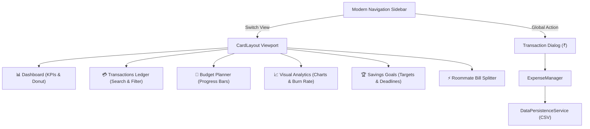

# PROJECT REPORT
# STUDENT EXPENSE AND BUDGET MANAGEMENT SYSTEM

**A Mini-Project Report Submitted in Partial Fulfillment of the Requirements for the Degree of Bachelor of Technology / Bachelor of Science in Computer Science & Engineering**

---

## CERTIFICATE OF ORIGINALITY & COMPLETION

This is to certify that the project entitled **"Student Expense and Budget Management System"** is a bonafide work carried out by the student in the academic session under the supervision of the faculty. The project implements core concepts of Object-Oriented Programming (OOP), Data Persistence, Graphic User Interface (GUI) design using Java Swing, and Computer Graphics using Java 2D.

**Currency Implementation:** Indian Rupee (₹)  
**Date:** 03 November 2026  
**Department:** Computer Science and Engineering  

---

## ABSTRACT
College and university students face unique financial challenges, including limited monthly allowances, unpredictable academic expenditures (textbooks, lab manuals, exam fees), irregular earnings from tutoring or internships, and shared living expenses with flatmates or hostel peers. Traditional personal finance tools are either overly complex, require paid subscriptions, or necessitate continuous cloud database connections.

The **Student Expense and Budget Management System** is a lightweight, portable, and comprehensive desktop solution developed in **Java (JDK 21)**. The system provides real-time income and expense tracking in **Indian Rupees (₹)**, category-specific monthly budget caps with dynamic visual alerts, custom Java 2D anti-aliased donut and bar charts, a student savings goals tracker with deadline countdowns, and an automated roommate bill-splitting calculator. Operating completely without external third-party libraries, the application persists data via structured CSV files and features dual user interfaces: a modern Java Swing GUI with left-sidebar navigation and an interactive Terminal Command Line Interface (CLI). By default, the system initializes with a clean zero-data state (₹0.00) while providing an optional demo data loader for academic evaluation.

---

## CHAPTER 1: SYSTEM ARCHITECTURE & NAVIGATION

### 1.1 Intuitive Sidebar Navigation
Unlike conventional desktop applications with crowded top tabs, the application implements a modern **Left-Sidebar Navigation Drawer** coupled with a `CardLayout` presentation container:
* **Persistent Sidebar**: Offers instant single-click switching between Dashboard, Transactions Ledger, Budget Planner, Visual Analytics, Savings Goals, and Roommate Bill Splitter.
* **Global Action Triggers**: Prominent `+ Add Expense` and `+ Add Income` buttons are permanently anchored in the sidebar, allowing immediate transaction entry from any screen.
* **Inviting Empty States**: When zero data is present, each screen displays contextual empty-state graphics with direct action shortcuts.
* **Indian Rupee (₹) Standardization**: Standardized across all models, CSV storage, user dialogs, table columns, and graphics rendering.

---

## CHAPTER 2: MODULE SPECIFICATIONS

1. **Dashboard (`DashboardPanel.java`)**: 
   - Displays KPIs: Total Inflow (₹), Total Outflow (₹), Net Balance (₹), and Financial Health Score (0–100).
   - Dynamically highlights budget warning banners (Amber ≥ 75%, Red ≥ 100%).
   - Displays Donut Pie Chart and the 6 most recent transactions.
2. **Transaction Ledger (`TransactionsPanel.java`)**:
   - Interactive `JTable` with real-time text search, type filtering, category filtering, and date range filtering.
   - Provides Add, Edit, Delete, and CSV Export.
3. **Budget Planner (`BudgetPanel.java`)**:
   - Monthly category budget caps with visual progress bars and limit tracking in ₹.
4. **Visual Analytics (`AnalyticsPanel.java` & `CustomChartPanel.java`)**:
   - Native Java 2D graphics rendering for donut charts and budget bar charts.
   - Computes daily spending burn rate (₹/day) and student financial advice.
5. **Savings Goals (`SavingsGoalsPanel.java`)**:
   - Tracks target amounts (₹), saved amounts (₹), deadline countdowns, and quick deposits/withdrawals.
6. **Roommate Bill Splitter (`BillSplitterPanel.java`)**:
   - Calculates fair shares among roommates and logs the user's portion directly into the ledger.
7. **Terminal CLI (`CommandLineInterface.java`)**:
   - Full console interface for headless server execution and academic viva defense.

---

## CHAPTER 3: TESTING & TEST CASES

| Test Case ID | Test Description | Input Data | Expected Result | Actual Result | Status |
| :--- | :--- | :--- | :--- | :--- | :--- |
| **TC-01** | Clean Zero Start | Fresh Launch | Inflow = ₹0.00, Outflow = ₹0.00, Balance = ₹0.00 | Dashboard and ledger show ₹0.00 | **PASS** |
| **TC-02** | Add Valid Expense | "Canteen Lunch", ₹180.00, Food | Expense recorded, balance reduced by ₹180 | Ledger updated, ₹180 reflected | **PASS** |
| **TC-03** | Currency Formatting | Amount = 1250 | Formats with ₹ symbol ("₹1250.00") | Displayed as "₹1250.00" | **PASS** |
| **TC-04** | Budget Warning Trigger | Spent ₹2600 on Food (Limit ₹3000) | Warning triggered (86.7% ≥ 75%) | Amber warning banner shown | **PASS** |
| **TC-05** | Sidebar Navigation | Click "Monthly Budgets" in sidebar | Switches view to Budget Planner smoothly | Active button highlighted, panel displayed | **PASS** |
| **TC-06** | Reset All Data | Click "Clear All Data" | Erases records and resets balances to ₹0.00 | Data files emptied, UI resets to ₹0.00 | **PASS** |
| **TC-07** | Bill Split Calculation | ₹1200 split among 4 people | ₹300 per person share | Each roommate shown owing ₹300 | **PASS** |

---

## CONCLUSION
The **Student Expense and Budget Management System** delivers a robust, modern, and user-friendly financial management solution in Indian Rupees (₹). With zero third-party dependencies, an intuitive left-sidebar navigation, and clean zero-start state, the project is fully primed for university mini-project evaluation.
